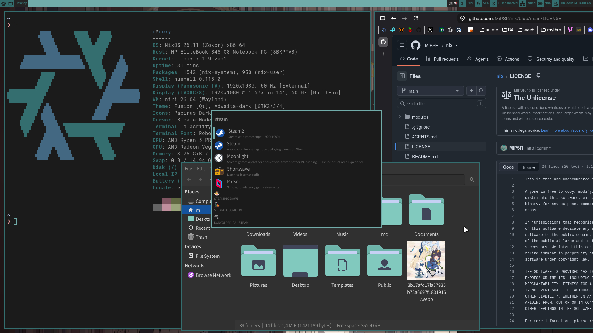

# NixOS configurations

This repository contains my personal NixOS configurations for various machines.

## Machines

### Laptop: roxy
An **HP EliteBook 845 G8** laptop with a **Ryzen 5 5650U**.
Mainly used as a **Moonlight** client that plays gacha and rhythm games, and handles software development with Nix shells.

## Usage

Machines are bound to one of two **profiles** (`server`, `laptop`)
via `mkHost` in `flake.nix`.

Nix **Flakes** manage the configurations, automatically selecting the correct
machine recipe based on the **hostname**.

## Shared across machines
- **Noctalia** family on the PCs: **Umbriel** compositor, **Noctalia** shell and
  **noctalia-greeter** (`modules/features/umbriel.nix`). X11 is disabled.
- **fish** as interactive shell, configured system-wide via `programs.fish`
  (`modules/features/fish.nix`).
- **Steam** with an optional **GameScope** session on the gaming PCs
  (`modules/features/steam.nix`).
- **Linux Zen** kernel on the PCs, latest on the servers.
- Locale is set to `en_US.UTF-8`, with regional settings in `fr_FR`.

## Shell aliases

Defined system-wide for **fish** via `programs.fish`
(`modules/features/fish.nix`).

### Desktop maintenance
* `fix-audio`: restarts PipeWire and PipeWire PulseAudio.

### NixOS management
* `nf`: updates the flake lock from `~/code/nix`.
* `ns`: rebuilds the system from `~/code/nix` and applies it instantly.
* `nb`: rebuilds the system from `~/code/nix` and applies it after reboot.
* `nt`: rebuilds the system from `~/code/nix` and applies it temporarily.
* `cln`: cleans the system by removing old generations and optimising the Nix store.

### Laziness
* `ff`: `fastfetch`.
* `l`: list files.
* `la`: list all files (`ls -a`).
* `ll`: list files in long format (`ls -l`).
* `lla`: list all files in long format (`ls -la`).

## Container Bind Mounts

| Container | Host Path | Container Path | Read-Only |
|-----------|-----------|----------------|-----------|
| vaultwarden | /var/lib/vaultwarden | /var/lib/vaultwarden | false |
| vaultwarden | /etc/vaultwarden/secrets.env | /run/secrets/vaultwarden.env | true |
| minecraft | /var/lib/minecraft | /var/lib/minecraft | false |
