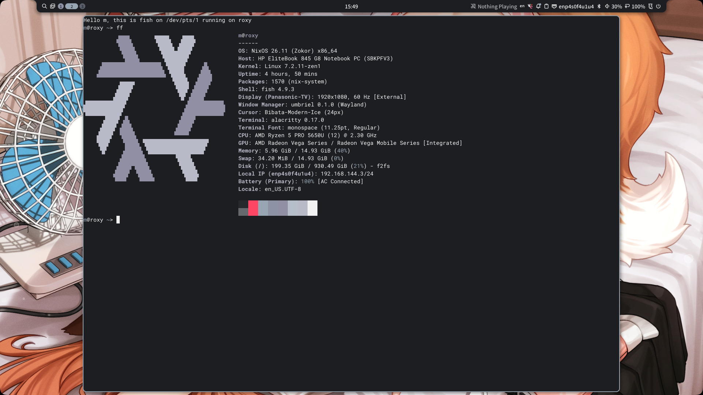

# NixOS configurations
<p align="center"></p>

This repository contains my personal NixOS configurations for various machines.

## Machines

### Laptop: roxy
An **HP EliteBook 845 G8** laptop with a **Ryzen 5 5650U**.
Mainly used as a **Moonlight** client that plays gacha and rhythm games, and handles software development with Nix shells.

## Usage

Machines are bound to one of two **profiles** (`server`, `laptop`)
via `mkHost` in `flake.nix`.

Nix **Flakes** manage the configurations, automatically selecting the correct
machine recipe based on the **hostname**.

## Shared across machines
- **Noctalia** family on the PCs: **Umbriel** compositor, **Noctalia** shell and
  **noctalia-greeter** (`modules/features/umbriel.nix`). X11 is disabled.
- **fish** as interactive shell, configured system-wide via `programs.fish`
  (`modules/features/fish.nix`).
- **Steam** with an optional **GameScope** session on the gaming PCs
  (`modules/features/steam.nix`).
- **Linux Zen** kernel on the PCs, latest on the servers.
- Locale is set to `en_US.UTF-8`, with regional settings in `fr_FR`.

## Shell aliases

Defined system-wide for **fish** via `programs.fish`
(`modules/features/fish.nix`).

### Desktop maintenance
* `fix-audio`: restarts PipeWire and PipeWire PulseAudio.

### NixOS management
* `nf`: updates the flake lock from `~/code/nix`.
* `ns`: rebuilds the system from `~/code/nix` and applies it instantly.
* `nb`: rebuilds the system from `~/code/nix` and applies it after reboot.
* `nt`: rebuilds the system from `~/code/nix` and applies it temporarily.
* `cln`: cleans the system by removing old generations and optimising the Nix store.

### Laziness
* `ai`: switches to the `kzk` user (login shell, home `/home/kzk`).
* `ff`: `fastfetch`.
* `l`: list files.
* `la`: list all files (`ls -a`).
* `ll`: list files in long format (`ls -l`).
* `lla`: list all files in long format (`ls -la`).

## Container Bind Mounts

| Container | Host Path | Container Path | Read-Only |
|-----------|-----------|----------------|-----------|
| vaultwarden | /var/lib/vaultwarden | /var/lib/vaultwarden | false |
| vaultwarden | /etc/vaultwarden/secrets.env | /run/secrets/vaultwarden.env | true |
| minecraft | /var/lib/minecraft | /var/lib/minecraft | false |
| wireguard | /var/lib/wireguard | /var/lib/wireguard | false |

## WireGuard

Generate a client QR code: `qrencode -t ansiutf8 < client.conf`

--------------

# Temporary new README candidate

# NixOS configurations
<p align="center"></p>

This repository contains my personal NixOS configurations for various machines.
It uses **Nix Flakes** and small, reusable modules to keep host-specific
hardware and software separate from shared machine profiles.

## Machines

### Laptop: roxy
An **HP EliteBook 845 G8** with a **Ryzen 5 5650U**. Mainly used as a
**Moonlight** client for gacha and rhythm games, and for software development
with Nix shells. It uses the PC profile, with laptop, AMD GPU, SSD, Steam and
osu! modules.

### PC: lana
A PC configuration with the shared PC profile, AMD GPU support, VR, and both
osu!stable and osu!lazer.

### PC: ui
A PC configuration for retro gaming, with AMD GPU support, Steam, VR and SSD
support.

### Server: homura
The server configuration. It uses the server profile and includes Caddy,
Minecraft, Vaultwarden and WireGuard, along with LAN and Wi-Fi networking
features.

## How it is organised

- `flake.nix` loads the Nix modules and declares the flake inputs.
- `modules/hosts/` contains a NixOS configuration and hardware module for each
  machine.
- `modules/profiles/` defines shared `pc` and `server` profiles.
- `modules/features/` contains optional system features, such as Steam, VR,
  WireGuard and desktop configuration.

Each host imports a profile and the features it needs. The PC profile uses the
**Linux Zen** kernel and includes the base system, GUI, Umbriel desktop and user
configuration. The server profile uses the latest Linux kernel and includes the
base system and user configuration.

## Shared across machines

- **fish** is the interactive shell, configured system-wide via
  `programs.fish` (`modules/features/fish.nix`).
- The PC profile includes **Umbriel**, **Noctalia** and
  **noctalia-greeter** (`modules/features/umbriel.nix`). X11 is disabled.
- The PC profile uses the **Linux Zen** kernel; the server profile uses the
  latest Linux kernel.
- Locale is set to `en_US.UTF-8`, with regional settings in `fr_FR`.

## Usage

Build or switch to a machine configuration with its hostname as the flake
target, for example:

```sh
nixos-rebuild switch --flake .#roxy --sudo
```

Replace `roxy` with `lana`, `ui` or `homura` for the other machines. The
configurations are declared in each host's `modules/hosts/<name>/host.nix`.

## Shell aliases

Defined system-wide for **fish** via `programs.fish`
(`modules/features/fish.nix`).

### Desktop maintenance
* `fix-audio`: restarts PipeWire and PipeWire PulseAudio.

### NixOS management
* `nf`: updates the flake lock from `~/code/nix`.
* `ns`: rebuilds the system from `~/code/nix` and applies it instantly.
* `nb`: rebuilds the system from `~/code/nix` and applies it after reboot.
* `nt`: rebuilds the system from `~/code/nix` and applies it temporarily.
* `cln`: cleans the system by removing old generations and optimising the Nix store.

### Laziness
* `ai`: switches to the `kzk` user (login shell, home `/home/kzk`).
* `ff`: `fastfetch`.
* `l`: list files.
* `la`: list all files (`ls -a`).
* `ll`: list files in long format (`ls -l`).
* `lla`: list all files in long format (`ls -la`).

## Container Bind Mounts

| Container | Host Path | Container Path | Read-Only |
|-----------|-----------|----------------|-----------|
| vaultwarden | /var/lib/vaultwarden | /var/lib/vaultwarden | false |
| vaultwarden | /etc/vaultwarden/secrets.env | /run/secrets/vaultwarden.env | true |
| minecraft | /var/lib/minecraft | /var/lib/minecraft | false |
| wireguard | /var/lib/wireguard | /var/lib/wireguard | false |

## WireGuard

Generate a client QR code: `qrencode -t ansiutf8 < client.conf`
